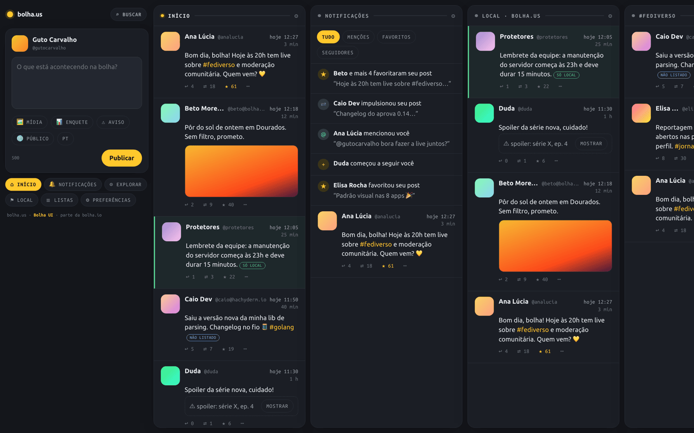
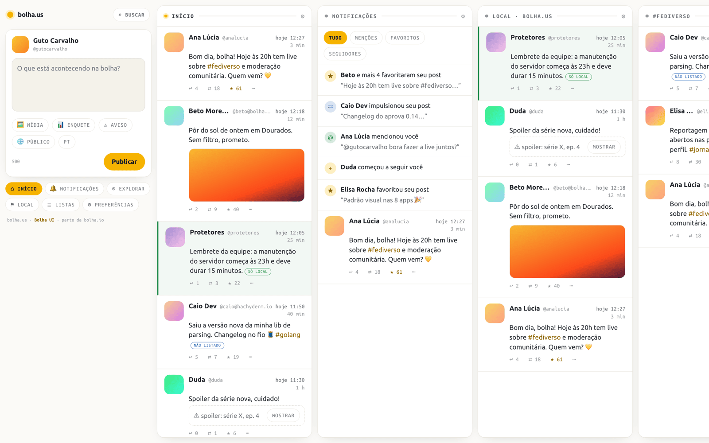
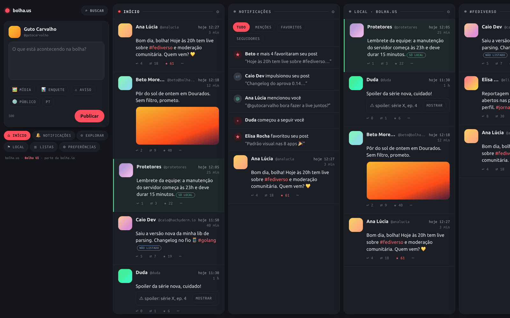
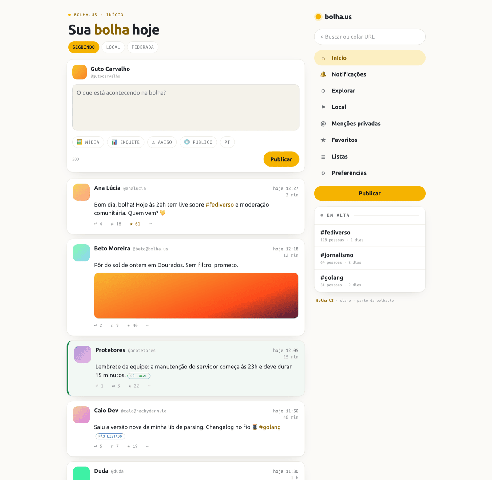
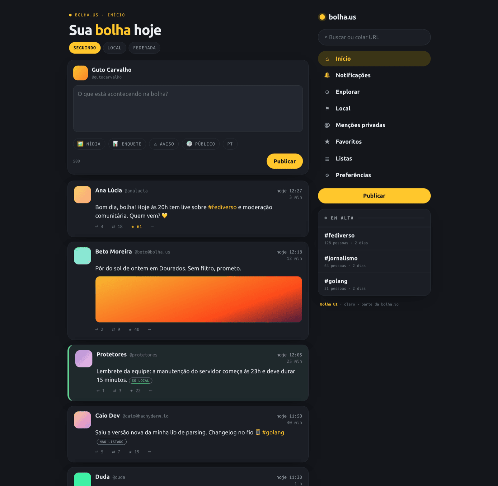
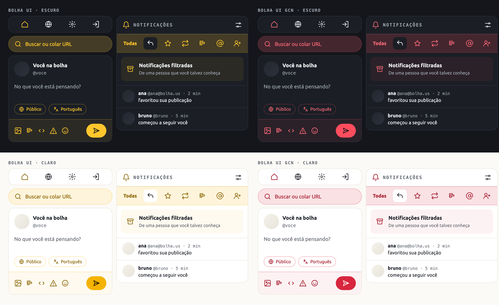

# Bolha UI for Mastodon

A warm, friendly theme for Mastodon's web interface, made for [bolha.us](https://bolha.us) and the
other [bolha.io](https://bolha.io) communities. Columns become cards, column headers and times are
set in a monospaced type, buttons and tabs are pills, and everything uses the bolha yellow (or the
red **GCN** variant).

It works in the **advanced web interface** (many columns), in the **single column** layout and on
phones, in **light, dark and high contrast**, following each person's own appearance settings.

[Português](README.pt-BR.md) · Website: [ui.bolha.us](https://ui.bolha.us/en/)



| Light | GCN variant (red) |
|---|---|
|  |  |

| Single column, light | Single column, dark |
|---|---|
|  |  |

Since 1.1.0 the accent tints the search box, the notification filters, the compose footer and the
filtered-notifications banner, in both variants, light and dark:



<sub>The screenshots are design mockups with made-up people and posts; the theme itself runs on
bolha.us and jornalismo.social.</sub>

## What you get

- **Two themes**: `Bolha UI` (yellow) and `Bolha UI GCN` (red), side by side with Mastodon's own.
- **Light, dark and high contrast** in each one: the theme follows the colour scheme and contrast
  each person picks in *Preferences › Appearance* (or their system's).
- **Ubuntu and Ubuntu Mono**, bundled with the theme, so everyone sees the same type. People who
  turn on *Use system's default font* get their system font, as usual.
- **Advanced web interface**: each column is a card, headers in mono capitals, the instance mascot
  centred at the bottom of the compose drawer without being cut.
- **Small and upgrade-friendly**: about 110 lines on top of Mastodon's default theme, almost all of
  them design tokens, so a Mastodon upgrade rarely breaks it.
- Tested on **Mastodon 4.7**. Older versions (before the 4.6 colour-scheme tokens) are not supported.

## Install

There are three ways, from the most complete to the quickest.

### 1. As a theme on your server (recommended)

You need shell access to the server's Mastodon source tree (a standard
[from-source install](https://docs.joinmastodon.org/admin/install/), usually `/home/mastodon/live`).

```sh
# as the mastodon user
cd ~
curl -fsSL "https://gitlab.gutocarvalho.net/open/bolha/mastodon-bolha-ui/-/jobs/artifacts/v1.2.0/raw/mastodon-bolha-ui.tar.gz?job=release" | tar -xz
./mastodon-bolha-ui-1.2.0-*/install.sh ~/live

cd ~/live
RAILS_ENV=production bundle exec rails assets:precompile
exit

# as root
systemctl restart mastodon-web mastodon-sidekiq mastodon-streaming
```

`install.sh` copies the theme into `app/javascript/styles`, the fonts into `app/javascript/fonts`,
the theme names into `config/locales` and adds two lines to `config/themes.yml`. It touches nothing
else. Run it with `--dry-run` first to see what it would do, and with `--uninstall` to remove it.

Then:

- **Each person** picks *Bolha UI* or *Bolha UI GCN (red)* in *Preferences › Appearance › Theme*.
- **To make it the default** for visitors and new accounts: *Administration › Server settings ›
  Appearance › Default theme*.

**Updating Mastodon:** the theme lives in files Mastodon doesn't ship, so `git pull`/`git checkout`
of a new version keeps them, except for `config/themes.yml`. If Git complains about it, stash, check
out the new version and run `install.sh` again. Then precompile and restart as usual.

### 2. With Docker

The official images have their assets built in, so the theme needs its own image, built from the
Mastodon source with the theme added:

```sh
git clone https://github.com/mastodon/mastodon.git && cd mastodon
git checkout v4.7.5                      # the version you run
curl -fsSL "https://gitlab.gutocarvalho.net/open/bolha/mastodon-bolha-ui/-/jobs/artifacts/v1.2.0/raw/mastodon-bolha-ui.tar.gz?job=release" | tar -xz -C ..
../mastodon-bolha-ui-1.2.0-*/install.sh .
docker build -t my-registry/mastodon:v4.7.5-bolha-ui .
```

Use that image for the `web` and `sidekiq` services (the `streaming` image doesn't change), then pick
the theme as in option 1.

### 3. As custom CSS (no server access needed)

Admins can paste the plain-CSS build into *Administration › Server settings › Appearance › Custom
CSS*: [`dist/bolha-ui.css`](dist/bolha-ui.css) (yellow) or [`dist/bolha-ui-gcn.css`](dist/bolha-ui-gcn.css)
(red). It applies to everyone, on top of whatever theme each person uses.

The same file works as a personal style with a browser extension such as
[Stylus](https://github.com/openstyles/stylus), for any Mastodon 4.7 server.

This way has no bundled fonts (Mastodon doesn't allow fonts from other sites): Ubuntu shows where it
is installed, the system font elsewhere.

## Versions

Versions look like `X.Y.Z-BUILD`. `X.Y.Z` is in the `VERSION` file and follows SemVer, and `BUILD` is
the GitLab pipeline number of the release. Each `vX.Y.Z` tag publishes a release tarball (the
`release` job's artifact, kept forever) with that version built in; the install commands above use
it. A copy from `main` or from a plain tag archive shows `X.Y.Z-dev`.

The theme carries its version in `--bolha-ui-version`: anything with the class `bolha-ui-version`
shows "Bolha UI X.Y.Z-BUILD" (bolha.us shows it in the sidebar footer), and `install.sh` prints it.

What changed in each version is in [CHANGELOG.md](CHANGELOG.md). Add an entry when you bump
`VERSION`: CI fails without it.

## Architecture

Why it exists: bolha.us used [Tangerine UI](https://github.com/mattbirchler/TangerineUI-for-Mastodon),
a full stylesheet of around 9,000 lines laid over Mastodon. It looks great, but every Mastodon release
can rename a class and break it, and features of our own had to fight it. Mastodon 4.6 and later
describe their look with design tokens (`--color-bg-primary`, `--color-text-brand`…) for dark, light
and high contrast. Bolha UI sets those tokens and adds only what tokens can't reach.

How it works, step by step:

1. `bolha-ui.scss` loads Mastodon's own `application.scss` (the default theme), then the fonts, then
   `bolha-ui/_theme.scss`.
2. `_theme.scss` replaces the grey and indigo scales with warm neutrals and the family accent, and
   sets the text, background, border and brand tokens for `[data-color-scheme='dark']`,
   `[data-color-scheme='light']` and `[data-contrast='high']`. Mastodon sets those attributes from
   each person's preferences, so the theme follows them.
3. A few component rules finish the look: columns as cards, mono column headers, pill buttons and
   tabs, mono handles and times, and the mascot in the compose drawer.
4. `bolha-ui-gcn.scss` is the same plus `_gcn.scss`, which only swaps the accent variables.

| Path | What |
|---|---|
| `src/app/javascript/styles/bolha-ui.scss`, `bolha-ui-gcn.scss` | the two themes, as listed in `config/themes.yml` |
| `src/app/javascript/styles/bolha-ui/_theme.scss` | tokens and component rules (the theme) |
| `src/app/javascript/styles/bolha-ui/_gcn.scss` | the red accent |
| `src/app/javascript/styles/bolha-ui/_fonts.scss` | `@font-face` for Ubuntu and Ubuntu Mono |
| `src/app/javascript/fonts/bolha-ui/` | the woff2 files (latin, latin-ext) and their licence |
| `src/config/locales/bolha-ui.yml` | theme names in the theme picker |
| `dist/` | plain-CSS builds for custom CSS / Stylus (`scripts/build-dist.sh`) |
| `install.sh` | installs or removes the theme in a Mastodon tree |
| `site/` | [ui.bolha.us](https://ui.bolha.us), the theme's page (`python3 site/build.py`, GitLab Pages) |

## Testing and security

Every push runs, in GitLab CI:

- **sass**: both themes compile with Dart Sass (Mastodon's `application.scss` replaced by a stub).
- **dist**: `dist/` matches the sources (`scripts/build-dist.sh --check`).
- **install**: `scripts/test-install.sh` installs into a throwaway fake Mastodon tree, installs again
  (nothing duplicated), checks that `--dry-run` changes nothing and that `--uninstall` brings the tree
  back to how it was.
- The shared security stage: gitleaks (secrets) and trivy block the pipeline; shellcheck, yamllint,
  semgrep and poutine report.

The theme is only CSS and fonts: no JavaScript, nothing that talks to other servers, and the custom
CSS build works inside Mastodon's default content security policy. `install.sh` only writes the theme's
own files and two lines of `config/themes.yml` in the directory you give it.

To report a security problem, write to contato@gutocarvalho.net.

## Credits and licence

- Theme: © Guto Carvalho and the bolha.io community, [AGPL-3.0](LICENSE), like Mastodon.
- [Ubuntu and Ubuntu Mono](https://design.ubuntu.com/font) by Dalton Maag for Canonical, under the
  [Ubuntu Font Licence 1.0](src/app/javascript/fonts/bolha-ui/LICENCE.txt), woff2 files from
  [Fontsource](https://fontsource.org).
- Inspired by [Tangerine UI](https://github.com/mattbirchler/TangerineUI-for-Mastodon) by
  Nileane and Matt Birchler, which showed how much a theme can do for Mastodon.

Part of the [bolha.io](https://bolha.io) open source projects: [opensource.bolha.io](https://opensource.bolha.io).
