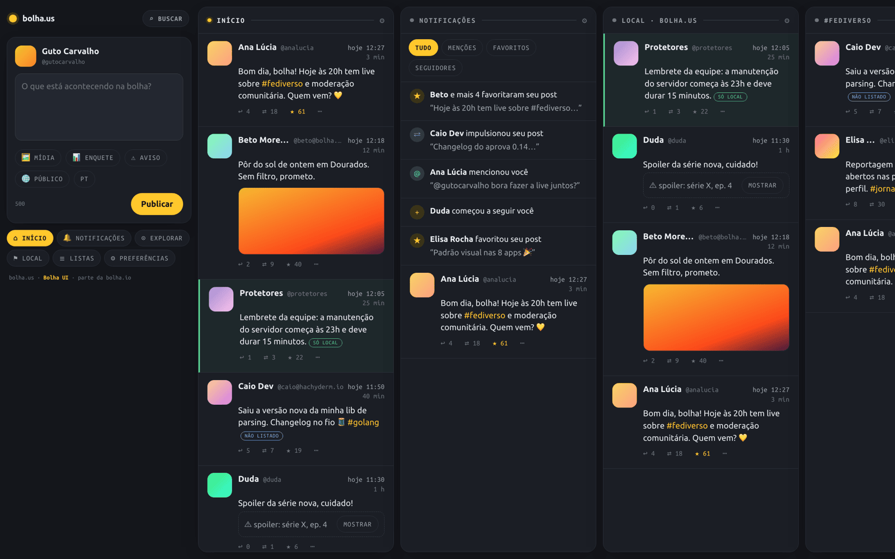
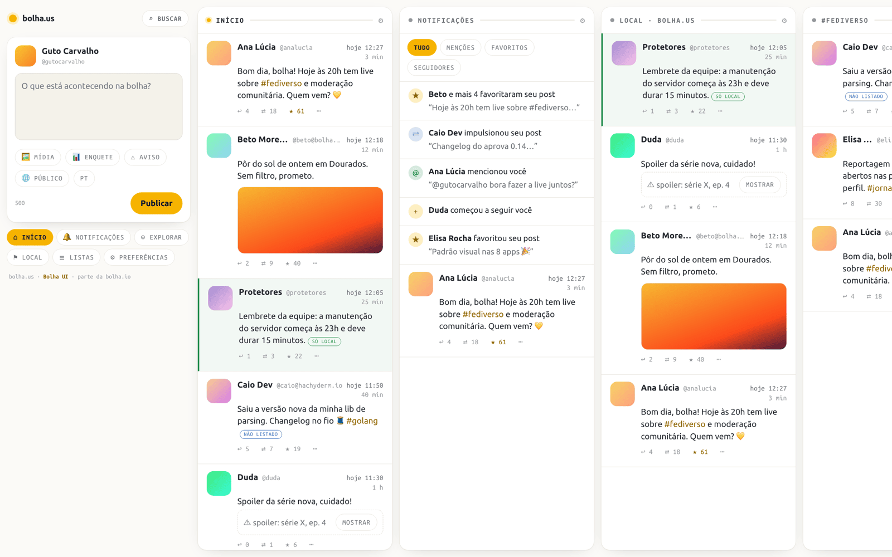
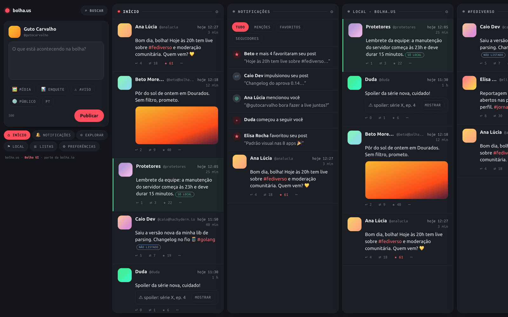

# Bolha UI para o Mastodon

Um tema acolhedor para a interface web do Mastodon, feito para o [bolha.us](https://bolha.us) e as
outras comunidades da [bolha.io](https://bolha.io). As colunas viram cartões, os cabeçalhos e os
horários usam fonte monoespaçada, botões e abas viram pílulas, tudo no amarelo da bolha (ou no
vermelho da variante **GCN**).

Funciona na **interface avançada** (várias colunas), na **coluna única** e no celular, no **claro,
escuro e alto contraste**, seguindo as preferências de aparência de cada pessoa.

[English](README.md)



| Claro | Variante GCN (vermelho) |
|---|---|
|  |  |

<sub>Os prints são mockups com pessoas e posts inventados; o tema em si roda no bolha.us e no
jornalismo.social.</sub>

## O que vem

- **Dois temas**: `Bolha UI` (amarelo) e `Bolha UI GCN` (vermelho), ao lado dos do Mastodon.
- **Claro, escuro e alto contraste** em cada um, conforme *Preferências › Aparência* (ou o sistema).
- **Ubuntu e Ubuntu Mono** embutidas no tema. Quem liga *Usar a fonte padrão do sistema* continua com
  a fonte do sistema.
- **Interface avançada**: cada coluna é um cartão, o mascote da instância centralizado no rodapé da
  gaveta de escrever, sem corte.
- **Pequeno e fácil de manter**: cerca de 110 linhas sobre o tema padrão, quase tudo tokens de design.
- Testado no **Mastodon 4.7**.

## Instalação

### 1. Como tema no servidor (recomendado)

Precisa de acesso ao código do Mastodon no servidor (instalação
[a partir do código](https://docs.joinmastodon.org/admin/install/), em geral `/home/mastodon/live`).

```sh
# como o usuário mastodon
cd ~
curl -fsSL "https://gitlab.gutocarvalho.net/open/bolha/mastodon-bolha-ui/-/jobs/artifacts/v1.2.0/raw/mastodon-bolha-ui.tar.gz?job=release" | tar -xz
./mastodon-bolha-ui-1.2.0-*/install.sh ~/live

cd ~/live
RAILS_ENV=production bundle exec rails assets:precompile
exit

# como root
systemctl restart mastodon-web mastodon-sidekiq mastodon-streaming
```

O `install.sh` copia o tema, as fontes e os nomes do tema para dentro do Mastodon e acrescenta duas
linhas no `config/themes.yml`; não mexe em mais nada. Use `--dry-run` para ver o que ele faria e
`--uninstall` para remover.

Depois, cada pessoa escolhe *Bolha UI* em *Preferências › Aparência › Tema*. Para virar o padrão do
site: *Administração › Configurações do servidor › Aparência › Tema padrão*.

### 2. Com Docker

As imagens oficiais já vêm com os assets compilados, então o tema pede uma imagem própria, feita a
partir do código do Mastodon com o tema dentro:

```sh
git clone https://github.com/mastodon/mastodon.git && cd mastodon
git checkout v4.7.5                      # a versão que você usa
curl -fsSL "https://gitlab.gutocarvalho.net/open/bolha/mastodon-bolha-ui/-/jobs/artifacts/v1.2.0/raw/mastodon-bolha-ui.tar.gz?job=release" | tar -xz -C ..
../mastodon-bolha-ui-1.2.0-*/install.sh .
docker build -t meu-registry/mastodon:v4.7.5-bolha-ui .
```

Use essa imagem no `web` e nos `sidekiq` (o `streaming` não muda).

### 3. Como CSS personalizado (sem acesso ao servidor)

Cole o [`dist/bolha-ui.css`](dist/bolha-ui.css) (amarelo) ou o [`dist/bolha-ui-gcn.css`](dist/bolha-ui-gcn.css)
(vermelho) em *Administração › Configurações do servidor › Aparência › CSS personalizado*. Vale para
todo mundo, por cima do tema de cada um. O mesmo arquivo serve como estilo pessoal com a extensão
[Stylus](https://github.com/openstyles/stylus). Nesse modo não há fontes embutidas: a Ubuntu aparece
onde estiver instalada, a fonte do sistema nos outros casos.

## Versões

As versões têm a forma `X.Y.Z-BUILD`: `X.Y.Z` vem do arquivo `VERSION` (SemVer) e `BUILD` é o número
da pipeline do GitLab que gerou a release. Cada tag `vX.Y.Z` publica um pacote com essa versão
embutida, que é o que os comandos acima baixam; uma cópia do `main` mostra `X.Y.Z-dev`. O tema
mostra a versão em tudo que tiver a classe `bolha-ui-version` (no bolha.us, no rodapé da barra
lateral). O que mudou em cada versão está no [CHANGELOG.md](CHANGELOG.md).

## Mais

Arquitetura, testes, segurança e licenças estão no [README em inglês](README.md). Licença AGPL-3.0;
fontes Ubuntu sob a Ubuntu Font Licence 1.0. Problemas de segurança: contato@gutocarvalho.net.
